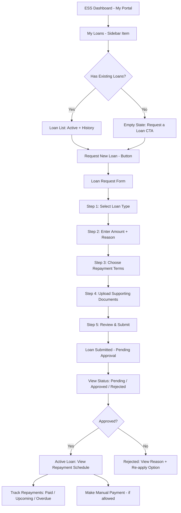
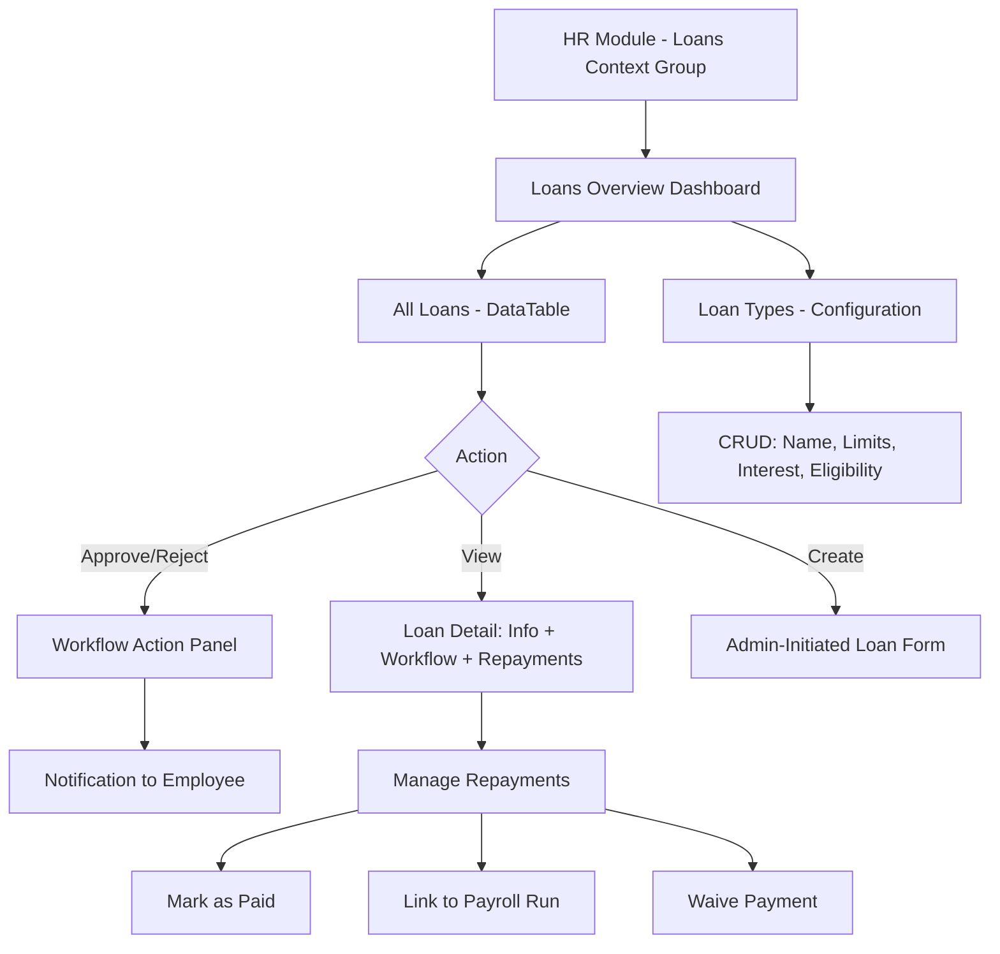
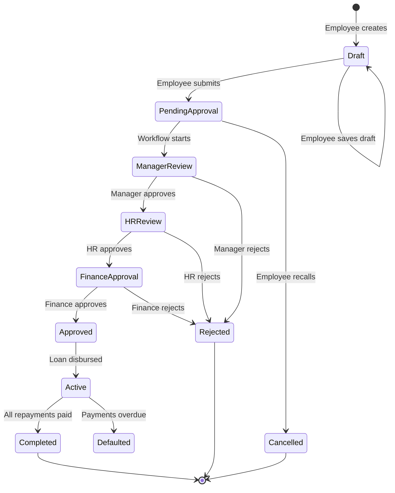

# Employee IOU/Loan Feature — Integration Analysis & Recommendation

> **Status**: Analysis Complete — Awaiting Review
> **Date**: 2026-10-15
> **Related**: [Policies Module Reference](src/../hr-consuming-app/docs/consuming-app/policies-module.md) · [Pre-Coding Checklist](docs/consuming-app/pre-coding-checklist.md) · [Library Independence Safeguards](docs/library/25-library-independence-safeguards.md)

---

## 1. Competitor Analysis Summary

### How Leading HR Platforms Handle Employee Loans/Advances

| Platform | Feature Name | Where It Lives | Employee Request Flow | Approval Workflow | Repayment Tracking | Payroll Integration |
|----------|-------------|----------------|----------------------|-------------------|-------------------|-------------------|
| **BambooHR** | ❌ No native loan module | N/A | N/A — requires third-party integration or custom fields | N/A | N/A | N/A |
| **Gusto** | Cash Accounts / Gusto Wallet | ESS dashboard + Payroll admin | Employee requests cash advance via Gusto Wallet app; amount capped at % of expected pay | Automatic (system-calculated eligibility) or manager approval for larger amounts | Automatic deduction from next paycheck(s); shown on payslip as "Cash Advance Repayment" | ✅ Deeply integrated — repayment is a payroll deduction line item |
| **Workday** | Worker Loans / Advances (via Compensation) | Compensation module (admin) + Worker Self-Service | Employee submits request through self-service; loan types configurable by HR | Configurable approval chain: Manager → HR → Compensation Admin | Amortization schedule tracked; payroll deduction configured as recurring element | ✅ Native — loan repayment is a compensation element in payroll |
| **HiBob** | Salary Advance / Loans (via Time & Attendance add-on) | ESS dashboard widget + Admin > Compensation | Employee requests from dashboard widget; sees available advance limit | Manager approval → HR confirmation | Tracked as "Advance Balance"; repaid via payroll deduction | ✅ Integrated with payroll via compensation module |
| **Zoho People** | Loan Management (standalone module) | Separate "Loans" module in HR suite | Employee submits loan request form with amount, reason, preferred repayment terms | Multi-level: Manager → HR → Finance | EMI schedule generated; monthly deductions tracked; loan balance dashboard | ⚠️ Partial — exports to payroll but no automatic deduction sync |
| **Deel** | Advance Salary / Deel Advance | Contractor self-service dashboard | Contractor requests advance up to $X based on contract value; instant eligibility check | Automated (risk-based) for small amounts; manual review for larger amounts | Deducted from next invoice/payment automatically | ✅ Native — built into payment infrastructure |
| **ADP** | Employee Loans (via ADP Workforce Now) | Payroll > Deductions > Loans | Admin-initiated (HR enters loan details); no employee self-service request flow | N/A (admin-managed) | Amortization schedule; payroll deduction configured as recurring deduction | ✅ Native — loan repayment is a standard deduction type |
| **Paychex** | Employee Advances / Loans | Payroll > Employee Maintenance > Deductions | Admin-initiated; no ESS request flow | N/A (admin-managed) | Manual tracking; payroll deduction as "Loan Repayment" deduction code | ✅ Native — deduction code integration |

### Key Patterns Observed

1. **Two distinct models exist**:
   - **Admin-managed** (ADP, Paychex): HR/payroll admin creates the loan record; no employee self-service request. Simpler but less empowering.
   - **ESS-driven** (Gusto, HiBob, Zoho, Deel): Employee initiates the request; approval workflow routes it. More modern, employee-centric.

2. **Payroll integration is the norm**: All platforms that offer loan features integrate repayment with payroll deductions. This is the primary differentiator from a simple "IOU tracker."

3. **Approval workflows are standard**: Manager → HR → Finance is the most common chain. Some platforms (Gusto, Deel) automate small-amount approvals.

4. **Repayment tracking varies**:
   - **Simple**: One-time deduction from next paycheck (Gusto cash advance)
   - **Complex**: Amortization schedule with EMI over multiple pay periods (Zoho, Workday)

5. **ESS discoverability**: Loan/advance features are typically surfaced on the ESS dashboard as a widget or in a "Financial" / "Compensation" section.

6. **None of the competitors have a standalone "IOU" module** — the feature is always tied to payroll/compensation because repayment is the critical path.

---

## 2. Current Module Gap Analysis

### What Exists (Reusable Infrastructure)

| Capability | Library/Module | Reusability for IOU/Loan |
|-----------|---------------|--------------------------|
| **DataTable** (CRUD lists) | Library `DataTable` + `DataTableForm` | ✅ Direct reuse — admin list of loan requests, ESS list of employee's loans |
| **Wizard** (multi-step forms) | Library `Wizard` + `WizardForm` | ✅ Reuse for loan request flow (amount → reason → terms → review) |
| **Workflow** (approval chains) | Library `Workflowable` + `HasWorkflow` + `WorkflowEngine` | ✅ Direct reuse — Manager → HR → Finance approval chain |
| **Notifications** (template-based) | Library `NotificationService` + `Data/notifications.php` | ✅ Reuse for submitted/approved/rejected/repaid notifications |
| **Documents** (file attachments) | Library `Documentable` + `HasDocuments` + `DocumentEngine` | ✅ Reuse for supporting documents (promissory note, bank details) |
| **Widgets** (dashboard cards) | Library `WidgetProcessor` + widget types | ✅ Reuse for ESS dashboard loan summary widget |
| **Navigation** (config-driven) | Library `NavigationManager` + `Config/navigation.php` | ✅ Reuse — add context group/items |
| **Field Types** (form fields) | Library `FieldFactory` (currency, datepicker, select, textarea, etc.) | ✅ Direct reuse |
| **Company Scope** | Library `HasCompanyScope` | ✅ Multi-company isolation |
| **Payroll Run** (deduction engine) | Payroll module `PayrollRun` + `PayrollRunAdjustment` | ⚠️ Partial — can add loan repayment as a deduction type, but needs new integration point |
| **Employee Model** | HR module `Employee` | ✅ Direct reuse — loan belongs to employee |
| **ESS Hub** (`my-portal`) | HR module navigation + views | ✅ Direct reuse — add "My Loans" sidebar item |

### What's Missing (Gaps to Fill)

| Gap | Description | Priority |
|-----|-------------|----------|
| **Loan data model** | No `Loan` / `LoanRequest` / `LoanRepayment` models exist | P0 — Foundation |
| **Loan request form** | No ESS form for employees to request loans | P0 — Core ESS UX |
| **Loan approval workflow** | No workflow definition for loan approval chain | P0 — Core admin UX |
| **Repayment schedule engine** | No logic to calculate EMI, generate repayment schedule, track paid/unpaid installments | P0 — Core feature |
| **Payroll deduction integration** | No mechanism to automatically add loan repayment as a payroll deduction | P1 — Key differentiator |
| **Loan balance/status dashboard** | No ESS widget showing outstanding balance, next payment, repayment progress | P1 — ESS UX |
| **Loan type configuration** | No admin interface to define loan types (advance salary, emergency loan, equipment loan, etc.) with limits, interest rates, max amounts | P1 — Admin UX |
| **Loan policy/eligibility rules** | No configurable rules (minimum tenure, maximum % of salary, co-signer requirements) | P2 — Advanced |
| **Loan reports** | No reports (outstanding loans, repayment forecast, loan aging) | P2 — Reporting |

---

## 3. Module Ownership Decision

### Option A: Standalone `Loans` Module (Recommended ✅)

**Structure**: `app/Modules/Loans/` — self-contained module following the Policies module pattern.

**Rationale**:
- Loans are a distinct business domain with their own models, workflows, and lifecycle
- Following the Policies module pattern ensures consistency and self-containment
- A standalone module can be copied to any fresh Laravel project with the UI library
- The Payroll module is already complex (runs, payslips, policies, adjustments); adding loans would bloat it
- The HR module is the ESS aggregation hub, not a business logic owner

**Trade-off**: Requires a new module entry in the module switcher (or can be nested under HR as a context group, like Policies).

### Option B: Payroll Context Group

**Structure**: Add `loans` context group to Payroll module's `Config/navigation.php`.

**Rationale against**: Loans are not purely payroll — they involve HR approval, employee self-service, and document management. The Payroll module is already large. Mixing concerns violates the self-contained module principle.

### Option C: HR Context Group (Like Policies)

**Structure**: Add `loans` context group to HR module's `Config/navigation.php`, with thin wrapper views.

**Rationale against**: While this works for Policies (which is a lightweight module), Loans has deeper integration needs (repayment schedules, payroll deduction). The HR module should remain the ESS aggregation hub, not a business logic owner.

### Decision: **Option A — Standalone `Loans` Module**

Following the Policies module hybrid architecture:
- **Business logic**: `app/Modules/Loans/` — self-contained
- **Admin navigation**: `loans` context group in HR module's `Config/navigation.php` (like Policies)
- **ESS navigation**: "My Loans" context item in HR module's `my-portal` context
- **Thin wrapper views**: In HR module's `Resources/views/` — render Loans module's Livewire components
- **Module switcher**: Optional — can be registered as a top-level module or nested under HR

---

## 4. Recommended Architecture

### 4.1 Module Structure

```
app/Modules/Loans/
├── Config/
│   ├── navigation.php          # Admin context groups + sidebar items
│   ├── permissions.php         # Spatie permissions
│   └── workflows.php           # Loan approval workflow definition
├── Console/
│   └── Commands/
│       └── ProcessLoanRepayments.php  # Scheduled command for due repayments
├── Data/
│   ├── loan.php                # DataTable config for admin loan list
│   ├── loan_type.php           # DataTable config for loan type management
│   ├── loan_repayment.php      # DataTable config for repayment tracking
│   ├── notifications.php       # Notification templates
│   └── dashboards/
│       ├── dashboard_loans_overview.php    # Admin dashboard
│       └── dashboard_my_loans.php          # ESS dashboard widget config
├── Database/
│   ├── Migrations/
│   │   ├── 2026_10_xx_000001_create_loan_types_table.php
│   │   ├── 2026_10_xx_000002_create_loans_table.php
│   │   └── 2026_10_xx_000003_create_loan_repayments_table.php
│   └── Seeders/
│       ├── LoanRoleSeeder.php
│       └── LoanNotificationTemplateSeeder.php
├── Http/
│   └── Livewire/
│       ├── LoanDataTable.php           # Custom DataTable (row actions: approve/reject)
│       ├── MyLoansHub.php              # ESS: employee's loan list + request button
│       ├── LoanRequestForm.php         # ESS: loan request wizard/form
│       ├── LoanDetail.php              # Detail view (admin + ESS)
│       └── LoanRepaymentSchedule.php   # Repayment schedule component
├── Listeners/
│   └── LoanEventListener.php          # DataTableRecordSaved → notifications
├── Models/
│   ├── LoanType.php                   # Configurable loan types
│   ├── Loan.php                       # Core loan model (implements Workflowable, Documentable)
│   └── LoanRepayment.php              # Individual repayment installments
├── Providers/
│   └── LoansServiceProvider.php       # Service provider
├── Resources/
│   └── views/
│       ├── livewire/
│       │   ├── my-loans-hub.blade.php
│       │   ├── loan-request-form.blade.php
│       │   ├── loan-detail.blade.php
│       │   └── loan-repayment-schedule.blade.php
│       └── (thin wrappers live in HR module)
├── Routes/
│   └── web.php                        # Explicit routes for create/edit/show
└── Services/
    ├── LoanCalculator.php             # EMI calculation, repayment schedule generation
    └── LoanRepaymentService.php       # Process repayments, mark paid, update balances
```

### 4.2 Data Model

```mermaid
erDiagram
    LoanType {
        int id PK
        int company_id FK
        string name "e.g., Salary Advance, Emergency Loan"
        string description
        decimal min_amount
        decimal max_amount
        decimal default_interest_rate "Annual percentage"
        int max_repayment_months
        boolean requires_approval
        boolean is_active
        json eligibility_rules "min_tenure_months, max_salary_percent"
        timestamps
    }

    Loan {
        int id PK
        int company_id FK
        int employee_id FK
        int loan_type_id FK
        string loan_number "Auto-generated: LN-2026-00001"
        decimal amount
        decimal interest_rate "At time of request"
        int repayment_months
        decimal monthly_installment "Calculated EMI"
        decimal total_repayable "Principal + Interest"
        decimal paid_amount "Running total"
        decimal balance "Remaining"
        string status "draft, pending_approval, approved, rejected, active, completed, cancelled"
        string reason "Employee's stated reason"
        text notes "Admin notes"
        date request_date
        date approval_date
        date start_date "First repayment date"
        date expected_end_date
        int approved_by "User ID"
        json repayment_schedule "Cached schedule for quick display"
        soft_deletes
        timestamps
    }

    LoanRepayment {
        int id PK
        int loan_id FK
        int payroll_run_id FK "Nullable — linked when deducted via payroll"
        decimal amount
        decimal principal
        decimal interest
        date due_date
        date paid_date
        string status "pending, paid, overdue, waived"
        string payment_method "payroll_deduction, manual, bank_transfer"
        string reference "Transaction reference"
        timestamps
    }

    Employee {
        int id PK
        int user_id FK
        int company_id FK
        string employee_number
        string first_name
        string last_name
    }

    LoanType ||--o{ Loan : "categorizes"
    Employee ||--o{ Loan : "requests"
    Loan ||--o{ LoanRepayment : "has schedule"
```

### 4.3 Key Model Contracts

```php
// Loan model implements both Workflowable and Documentable
class Loan extends Model implements Workflowable, Documentable
{
    use HasCompanyScope;
    use HasWorkflow;
    use HasDocuments;
    use SoftDeletes;

    // Workflowable
    public function getWorkflowDefinitionKey(): string
    {
        return 'loan_request';
    }

    public function getWorkflowContext(): array
    {
        return [
            'company_id' => $this->company_id,
            'employee_id' => $this->employee_id,
            'amount' => $this->amount,
            'loan_type_id' => $this->loan_type_id,
        ];
    }

    // Documentable
    public function getDocumentType(): string
    {
        return 'loan_request';
    }

    public function getDocumentStoragePath(): string
    {
        return 'loans/' . $this->id;
    }

    // Relationships
    public function employee() { ... }
    public function loanType() { ... }
    public function repayments() { ... }
    public function approvedBy() { ... }
}
```

### 4.4 Workflow Definition

```php
// Config/workflows.php
return [
    'loan_request' => [
        'label' => 'Loan Request Approval',
        'name' => 'Loan Request Approval',
        'entity_type' => 'Loan',
        'initiators' => ['employee', 'manager', 'super_admin'],
        'steps' => [
            [
                'name' => 'Manager Review',
                'step_type' => 'approval',
                'approval_mode' => 'any',
                'roles' => ['manager', 'supervisor'],
            ],
            [
                'name' => 'HR Review',
                'step_type' => 'approval',
                'approval_mode' => 'any',
                'roles' => ['hr_manager', 'hr_officer'],
            ],
            [
                'name' => 'Finance Approval',
                'step_type' => 'approval',
                'approval_mode' => 'any',
                'roles' => ['finance_manager', 'super_admin'],
            ],
        ],
        'notifications' => [
            'enabled' => true,
            'types' => [
                'submitted' => 'workflow_submitted',
                'submitted_initiator' => 'workflow_submitted_initiator',
                'approved' => 'workflow_approved',
                'rejected' => 'workflow_rejected',
                'recalled' => 'workflow_recalled',
                'cancelled' => 'workflow_cancelled',
                'stage_advanced' => 'workflow_stage_advanced',
                'workflow_completed' => 'workflow_completed',
            ],
        ],
    ],
];
```

---

## 5. UX Flow

### 5.1 Employee Self-Service (ESS) Flow



### 5.2 Admin Flow



### 5.3 Approval Workflow State Machine



---

## 6. Navigation Design

### 6.1 Admin Navigation (HR Module)

Add a `loans` context group to [`app/Modules/Hr/Config/navigation.php`](src/../hr-consuming-app/app/Modules/Hr/Config/navigation.php):

```php
'loans' => [
    'label' => 'Loans',
    'icon' => 'fas fa-hand-holding-usd',
    'order' => 700,  // After Policies (600)
    'route' => NULL,
    'url' => 'hr/dashboard-loans-overview',
    'permission' => 'view_loan',
    'roles' => ['hr_manager', 'hr_officer', 'finance_manager', 'super_admin', 'admin', 'company_admin'],
],
```

Context items:
```php
'loans' => [
    ['key' => 'loans_overview', 'label' => 'Overview', 'icon' => 'fas fa-chart-bar',
     'route' => '/hr/dashboard-loans-overview', 'permission' => 'view_loan', 'order' => 1],
    ['key' => 'loan_list', 'label' => 'All Loans', 'icon' => 'fas fa-list-alt',
     'route' => '/hr/loans', 'permission' => 'view_loan', 'order' => 10],
    ['key' => 'loan_type', 'label' => 'Loan Types', 'icon' => 'fas fa-cog',
     'route' => '/hr/loan-types', 'permission' => 'manage_loan_types', 'order' => 20],
    ['key' => 'loan_repayments', 'label' => 'Repayments', 'icon' => 'fas fa-calendar-check',
     'route' => '/hr/loan-repayments', 'permission' => 'view_loan', 'order' => 30],
],
```

### 6.2 ESS Navigation (HR Module `my-portal`)

Add to the `my-portal` context items:
```php
[
    'key' => 'my_loans',
    'label' => 'My Loans',
    'icon' => 'fas fa-hand-holding-usd',
    'route' => '/hr/my-loans',
    'permission' => 'view_my_portal',
    'order' => 6,  // After Company Policies (5)
],
```

### 6.3 Thin Wrapper Views (in HR Module)

Following the Policies pattern:

```blade
{{-- resources/views/my-loans.blade.php --}}
@php
    $employee = \App\Modules\Hr\Models\Employee::where('user_id', Auth::id())->first();
    if (!$employee) { abort(403); }
@endphp
<x-qf::navigation-layout context="my-portal" moduleName="hr" :overrides="[...]">
    @livewire('qf.loans.my-hub', ['employeeId' => $employee->id])
</x-qf::navigation-layout>
```

```blade
{{-- resources/views/loans.blade.php --}}
<x-qf::navigation-layout configKey="loans.loan" context="loans" moduleName="hr" :overrides=[]>
    <livewire:qf.loans.data-table config-key="loans.loan" />
</x-qf::navigation-layout>
```

---

## 7. Implementation Phases

### Phase 1: Foundation — Data Model + Admin CRUD

**Goal**: Loans exist in the database and admins can manage them.

| # | Task | Details |
|---|------|---------|
| 1.1 | Create `Loans` module directory structure | Follow [`pre-coding-checklist.md`](docs/consuming-app/pre-coding-checklist.md) §D |
| 1.2 | Create migrations | `loan_types`, `loans`, `loan_repayments` tables |
| 1.3 | Create models | `LoanType`, `Loan`, `LoanRepayment` with relationships, casts, scopes |
| 1.4 | Create `Data/loan.php` config | DataTable config with fieldDefinitions, controls, switchViews, moreActions |
| 1.5 | Create `Data/loan_type.php` config | CRUD config for loan type management |
| 1.6 | Create `LoansServiceProvider` | Register Livewire components, load migrations/views/routes |
| 1.7 | Create `LoanDataTable` | Extend base DataTable; add row actions (approve/reject) |
| 1.8 | Create admin thin wrapper views | `loans.blade.php`, `loan-types.blade.php` in HR module |
| 1.9 | Add `loans` context group to HR navigation | Admin sidebar items |
| 1.10 | Create permissions config + seeder | `view_loan`, `create_loan`, `edit_loan`, `delete_loan`, `manage_loan_types` |

### Phase 2: ESS — Employee Request Flow

**Goal**: Employees can request loans from the ESS portal.

| # | Task | Details |
|---|------|---------|
| 2.1 | Create `MyLoansHub` Livewire component | Lists employee's loans (active, pending, history) |
| 2.2 | Create `LoanRequestForm` Livewire component | Multi-step form: type → amount → reason → terms → documents → review |
| 2.3 | Create `Data/notifications.php` | Templates: loan_submitted, loan_approved, loan_rejected, repayment_due, repayment_overdue |
| 2.4 | Create ESS thin wrapper view | `my-loans.blade.php` in HR module |
| 2.5 | Add "My Loans" to `my-portal` context | ESS sidebar item |
| 2.6 | Create `LoanEventListener` | Handle `DataTableRecordSaved` → send notifications |
| 2.7 | Create ESS dashboard widget config | `dashboard_my_loans.php` — summary card for ESS dashboard |

### Phase 3: Approval Workflow

**Goal**: Loan requests go through Manager → HR → Finance approval.

| # | Task | Details |
|---|------|---------|
| 3.1 | Create `Config/workflows.php` | Define `loan_request` workflow with 3-step approval chain |
| 3.2 | Implement `Workflowable` on `Loan` model | `getWorkflowDefinitionKey()`, `getWorkflowContext()` |
| 3.3 | Add `HasWorkflow` trait to `Loan` | Morph relationships, status sync |
| 3.4 | Create workflow notification templates | Seed `workflow_submitted`, `workflow_approved`, `workflow_rejected`, etc. |
| 3.5 | Wire approval actions in `LoanDataTable` | `executeRowAction()` override for approve/reject events |
| 3.6 | Create `LoanDetail` component | Show loan info + workflow timeline + repayment schedule |
| 3.7 | Test full approval chain | Manager → HR → Finance → Approved status |

### Phase 4: Repayment Engine

**Goal**: Calculate repayment schedules, track payments, integrate with payroll.

| # | Task | Details |
|---|------|---------|
| 4.1 | Create `LoanCalculator` service | EMI calculation (principal + interest), schedule generation |
| 4.2 | Auto-generate repayment schedule on approval | Create `LoanRepayment` records for each installment |
| 4.3 | Create `LoanRepaymentSchedule` component | Visual schedule: paid (green), upcoming (blue), overdue (red) |
| 4.4 | Create `Data/loan_repayment.php` config | DataTable for admin repayment management |
| 4.5 | Create `ProcessLoanRepayments` command | Scheduled daily: mark overdue, send reminders |
| 4.6 | Register command in `app/Console/Kernel.php` | Daily schedule |

### Phase 5: Payroll Integration

**Goal**: Loan repayments automatically deducted from payroll runs.

| # | Task | Details |
|---|------|---------|
| 5.1 | Add "Loan Repayment" as a deduction type | In Payroll module's deduction types |
| 5.2 | Create integration point | When payroll run processes an employee, check for active loans with due repayments |
| 5.3 | Auto-create `PayrollRunAdjustment` | For each due repayment in the pay period |
| 5.4 | Link `LoanRepayment` to `PayrollRun` | Set `payroll_run_id` and mark as `paid` when payroll finalizes |
| 5.5 | Show loan deductions on payslip | Add line item in payslip detail |

### Phase 6: Advanced Features

| # | Task | Details |
|---|------|---------|
| 6.1 | Loan reports | Outstanding loans, repayment forecast, aging analysis |
| 6.2 | Loan type eligibility rules | Configurable: min tenure, max salary %, department restrictions |
| 6.3 | Bulk loan adjustments | Admin tool for interest rate changes, payment waivers |
| 6.4 | ESS dashboard widget | "My Loan Summary" card on ESS dashboard |
| 6.5 | Multi-currency support | Loan in employee's salary currency |

---

## 8. Library vs Consuming App Boundary

### ✅ Belongs in Consuming App (`app/Modules/Loans/`)

| Item | Reason |
|------|--------|
| `Loan`, `LoanType`, `LoanRepayment` models | Domain-specific entities |
| `LoanCalculator` service | Domain-specific EMI/amortization logic |
| `LoanRequestForm`, `MyLoansHub` components | Domain-specific UI |
| `Data/loan.php`, `Data/loan_type.php` configs | Domain-specific data configs |
| `Config/workflows.php` | Domain-specific approval chain |
| `Config/navigation.php` | Domain-specific navigation items |
| `Data/notifications.php` | Domain-specific notification templates |
| All migrations, seeders, routes | Domain-specific infrastructure |

### ✅ Reused from Library (No Changes Needed)

| Library Component | How It's Used |
|-------------------|---------------|
| `DataTable` + `DataTableForm` | Admin loan list, loan type CRUD |
| `Workflowable` contract + `HasWorkflow` trait | Loan approval workflow |
| `WorkflowEngine` | Process approval actions |
| `Documentable` contract + `HasDocuments` trait | Supporting document uploads |
| `DocumentEngine` | Document storage/retrieval |
| `NotificationService` | Send loan-related notifications |
| `NavigationManager` + `NavigationLayout` | Sidebar, topnav, context groups |
| `FieldFactory` | Form field rendering (currency, datepicker, select, textarea) |
| `HasCompanyScope` | Multi-company data isolation |
| `WidgetProcessor` | Dashboard widgets |

### ⚠️ Potential Library Additions (Only If Domain-Agnostic)

| Candidate | Two-Domain Test | Verdict |
|-----------|----------------|---------|
| `AmortizationCalculator` | Works for loans (HR), equipment financing (ERP), mortgage (Real Estate) | ✅ Could be a library utility |
| `InstallmentSchedule` widget | Works for loans, subscription billing, equipment leasing | ✅ Could be a library widget |
| `EMI` field type | Too specific to loans | ❌ Belongs in consuming app |

**Recommendation**: No library changes needed for Phase 1-3. If `AmortizationCalculator` proves generically useful, extract to library in Phase 4+.

---

## 9. Risks and Mitigations

| Risk | Impact | Mitigation |
|------|--------|------------|
| **Payroll integration complexity** | Loan deductions not synced with payroll → manual reconciliation | Phase 5 carefully; use existing `PayrollRunAdjustment` pattern; test with mock payroll runs |
| **Interest calculation compliance** | Varies by jurisdiction (flat vs reducing balance, usury laws) | Make `LoanCalculator` configurable; default to simple interest for MVP; document assumptions |
| **Employee over-borrowing** | Multiple simultaneous loans → unmanageable debt | Add eligibility rules: max 1 active loan, max % of salary, cooling-off period between loans |
| **Workflow bypass** | Admin directly sets status without approval | Use model events/observers to enforce status transitions; only `WorkflowEngine` changes status |
| **Navigation bloat** | HR module context groups grow too large | Use overflow/promotion algorithm (already built into TopNav); consider collapsing into "More" |
| **Data privacy** | Loan amounts visible to unauthorized users | Use `HasCompanyScope` + permission checks; ESS views scoped to `Auth::user()` employee |
| **Stale vendor files** | Library changes not reflecting | Follow [Debug Checklist §8](docs/debug-checklist.md) — copy to vendor after changes |

---

## 10. Key Design Decisions Summary

| Decision | Choice | Rationale |
|----------|--------|-----------|
| Module ownership | Standalone `Loans` module | Self-contained, follows Policies pattern, avoids bloating Payroll/HR |
| Admin navigation | `loans` context group in HR module | Consistent with Policies pattern; HR is the admin hub |
| ESS navigation | `my-portal` context item | Consistent with Policies, Leave, Team Calendar |
| `crudType` | `'pages'` (full-page) | Loan forms are content-heavy (like Policies); drawers too cramped |
| Approval chain | 3-step: Manager → HR → Finance | Industry standard; configurable via workflow definition |
| Repayment method | EMI (equated monthly installment) | Standard for multi-period loans; simple interest for advances |
| Payroll integration | `PayrollRunAdjustment` pattern | Reuses existing infrastructure; no new deduction engine needed |
| Document support | `Documentable` + `HasDocuments` | Reuses library; promissory notes, bank details, signed agreements |
| Notifications | Template-based via `Data/notifications.php` | Consistent with Policies and Payroll modules |

---

## Next Steps

1. **Review this plan** — Confirm module ownership, navigation structure, and phase priorities
2. **Approve Phase 1 scope** — Foundation: data model + admin CRUD
3. **Switch to Code mode** — Execute Phase 1 implementation
4. **Iterate** — Review each phase before proceeding to the next

---

> **Ready for review.** Switch to Code mode when the plan is approved to begin Phase 1 implementation.